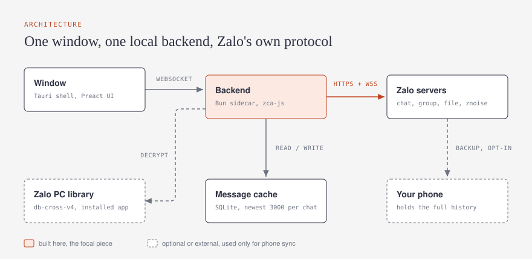
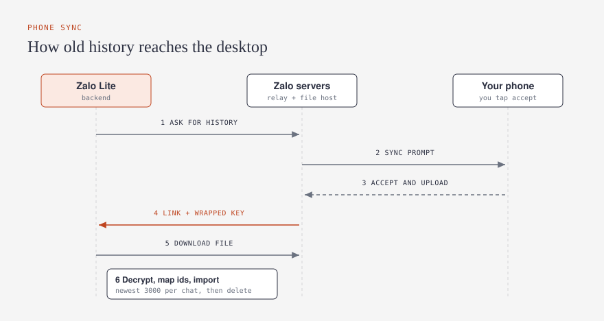

<p align="center"></p>

<h1 align="center">Zalo Lite</h1>

A lightweight desktop client for the messaging part of [Zalo](https://zalo.me), built with **Tauri** (shell) and **Bun** (backend and tooling). Chat, groups, My Documents, photos, files, stickers and call records are in. Social features (Nhật ký, Cloud, mini-apps) are deliberately left out.

> **Unofficial.** Zalo Lite is not affiliated with or endorsed by VNG or Zalo. It talks to Zalo's servers the way Zalo's own clients do, using protocol details recovered from the Zalo PC app. Use it with your own account, at your own risk. See [Disclaimer](#disclaimer).

## Features

- **Sign in with a QR code** using Zalo PC's own login, with the web-style QR as a fallback. The session is saved locally and resumed on the next launch.
- **Conversations** sorted by recency: people, groups, official accounts and My Documents. Dark, light and system themes, laid out like Zalo PC.
- **Send and receive** text, photos, files, stickers (your own sticker packs plus search and a Recent tab), replies, reactions, recall, delete-for-me, typing indicators and read receipts.
- **Call records** shown as cards: incoming, missed and declined, with durations.
- **Older history from your phone.** Zalo keeps old 1:1 history on the phone and withholds group history from new devices, so Zalo Lite can pull a backup from the phone (you accept a prompt there) and import it. See [Phone sync](#phone-sync).
- **A bounded cache, not an archive.** Each chat keeps its newest 3,000 messages, and nothing is stored in the repository.

## Architecture



- The window never talks to Zalo directly. It talks to a Bun backend on `127.0.0.1` over a WebSocket, on a random port with a per-launch token, and the backend only accepts the app's own origins.
- The backend uses [zca-js](https://github.com/RFS-ADRENO/zca-js) for the protocol and adds the pieces Zalo PC does that zca-js does not: PC QR login, group-cloud history, the phone transfer.
- Messages live in a SQLite file in your user data folder, never in this repository.

## Phone sync



Settings menu, then **Đồng bộ tin nhắn từ điện thoại**. Your phone shows a sync prompt: accept it there. The backend then downloads the backup, decrypts it, maps Zalo's short ids to real ones, imports the newest messages per chat, and deletes everything it downloaded.

Decrypting needs the native library that ships with an installed **Zalo PC** (`/Applications/Zalo.app`). Without it, everything else still works. The full protocol write-up is in [docs/PROTOCOL.md](docs/PROTOCOL.md).

## Getting started

Requirements: macOS, [Bun](https://bun.sh), [Rust](https://rustup.rs) with the [Tauri prerequisites](https://tauri.app/start/prerequisites/). Zalo PC is optional (phone sync only).

```bash
bun install
bun run dev        # compiles the backend sidecar, then runs `tauri dev`
bun run build      # release .app / .dmg in src-tauri/target/release/bundle
bun run test       # backend unit tests
bun check          # type check
```

UI-only work in a browser: `bun run server` in one terminal and `bun run dev:web` in another, then open <http://localhost:1420>.

### Configuration

All optional, set as environment variables.

| Variable | Default | Purpose |
|---|---|---|
| `ZL_PORT` | `17789` | Backend port (the Tauri shell picks a random one) |
| `ZL_TOKEN` | empty | Token the window must present |
| `ZL_DATA` | `~/Library/Application Support/zalo-lite` | Where the session and message cache live |
| `ZL_LOGIN` | PC QR | Set to `web` to force the web-style QR login |
| `ZL_CACHE_PER_CHAT` | `3000` | Newest messages kept per conversation |

## Project layout

| Path | What is in it |
|---|---|
| `src/` | Preact UI: login, conversation list, chat, composer, sticker picker, styles |
| `server/` | Bun backend: login, sync, message store, normalization, phone transfer and backup reader, with tests |
| `src-tauri/` | Tauri v2 shell that launches the backend sidecar |
| `docs/PROTOCOL.md` | Endpoint map and every live finding about Zalo's protocol |
| `docs/design-audit-001.md` | UI audit report and the fixes that followed |
| `PRODUCT.md` | Product and design brief |

## Known limits

- **One web session at a time.** Like Zalo Web, signing in here signs out other web or PC sessions.
- **Group history.** Zalo withholds some group history from new devices; phone sync fills most of it.
- **Calls.** Call records are shown, but placing or answering calls is not supported.
- **Not implemented yet:** @mentions, forwarding, labels (Phân loại), video and voice calls, files over 100 MB.
- **macOS first.** The shell is Tauri, so other platforms are possible, but only macOS is tested.

## Contributing and security

See [CONTRIBUTING.md](CONTRIBUTING.md) and [SECURITY.md](SECURITY.md). Never commit a session file, cookie, key or message cache.

## Disclaimer

Zalo Lite does not bundle any Zalo assets, logos or code: the stylesheet, icons and application code are written from scratch, and the layout and colours follow what the real client looks like. The protocol notes in `docs/` come from studying software you have installed, for interoperability with your own account. Using unofficial clients may violate Zalo's terms of service and can get an account restricted. You are responsible for how you use it.

## License

[MIT](LICENSE)
